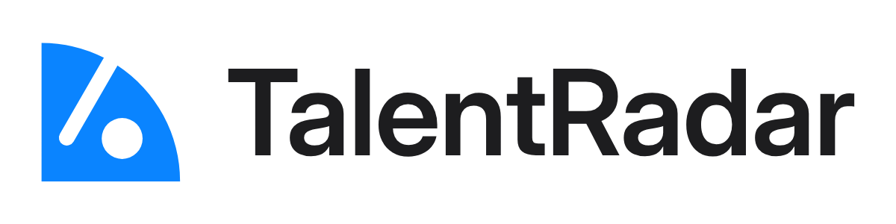

# TalentRadar logo — usage guide



## 1. The logo

**Idea:** a radar quadrant mid-sweep. The beam is cut in as one line, and the hole beside it is the blip it has
found: the one real signal in a noisy job market.

| Version | Use it for | File |
|---|---|---|
| Horizontal (primary) | site header, nav bar, documents, slides | `master/talentradar-horizontal-light.svg`, `-dark.svg` |
| Stacked | square-ish spaces: splash screens, stickers, merch | `master/talentradar-stacked-light.svg`, `-dark.svg` |
| Symbol | app icon, avatar, anywhere the name is already visible | `master/talentradar-symbol.svg` |
| Symbol, small cut | 16–24 px only: favicons, tab icons, tiny UI | `master/talentradar-symbol-small.svg` |
| Wordmark | when the symbol appears nearby on its own | `master/talentradar-wordmark-light.svg`, `-dark.svg` |

`-light` files have a dark wordmark for light backgrounds; `-dark` files have a light wordmark for the app's black UI.
The symbol is #0A84FF in both. One-colour black, white and blue versions of every lockup are in `exports/`.

## 2. Clear space

Keep a clear zone of **one blip diameter** on every side: about half the height of the capital T in the
lockups. The lockup SVGs already include this padding, so placing the file edge-to-edge is safe. Scale the zone
with the logo; never use a fixed distance.

## 3. Minimum size

| Version | Screen | Print |
|---|---|---|
| Horizontal | 120 px wide | 30 mm wide |
| Stacked | 80 px wide | 20 mm wide |
| Symbol | 24 px | 6 mm |
| Symbol, small cut | 16 px (the favicon files) | 4 mm |

Below 24 px always use the small cut: its beam and blip are drawn a pixel apart so they don't merge into a "6".

## 4. Colour

| Name | HEX | RGB | CMYK (approx.) | Role |
|---|---|---|---|---|
| Radar blue | `#0A84FF` | 10 132 255 | 96 48 0 0 | the symbol; the app's `--accent` |
| Ink | `#1D1D1F` | 29 29 31 | 6 6 0 88 | wordmark on light backgrounds |
| Paper | `#F5F5F7` | 245 245 247 | 1 1 0 3 | wordmark on dark backgrounds; the app's `--ink` |
| Black | `#000000` | 0 0 0 | 0 0 0 100 | the app background, `--paper` |

The CMYK values are an uncalibrated conversion and no Pantone has been chosen: have the printer match
#0A84FF on a proof. Contrast: blue on white is 3.6:1 and blue on black 5.8:1, both above the 3:1 needed for graphics.

**Approved pairs:** full colour on white or light grey · full colour (dark files) on black · white on Radar blue ·
black on white. On photos, use the white or black one-colour version on a calm area. Never put the blue symbol on a
blue background; use the white version there.

## 5. Typography

The wordmark is **Inter** (weight 600, optical size 32), tracked −1.2 % with the font's own kerning and converted to
outlines, so no file needs the font installed. Inter is under the SIL Open Font License, which permits logo use.
The app's interface type stays as it is (SF Pro with system fallbacks).

## 6. Don'ts

Don't stretch, squash or rotate the logo · don't recolour it outside the palette · don't add shadows, outlines,
glows or gradients · don't rearrange or resize the parts of a lockup · don't fill in the beam or the blip · don't
use the full symbol below 24 px · don't set "TalentRadar" in a font and call it the logo; use the files.

## 7. Files

```
master/         SVG masters (the only files to edit; regenerate with source/build_logo.py)
exports/symbol/ symbol variants, app icon, favicon.ico/.svg, PNG icon set, site.webmanifest, head-snippet.html
exports/horizontal, exports/stacked, exports/wordmark/
                one-colour SVGs plus 1200 px PNGs (light, dark, black, white, blue)
presentation/   board.html and slides/ (the identity shown in use)
concepts/, refine/
                the working rounds and test sheets, kept for reference
source/         build_logo.py: rebuilds master/ from the geometry and Inter
```

To rebuild after changing the geometry: `pip install fonttools`, fetch Inter's variable TTF from
github.com/google/fonts (`ofl/inter`), then `python brand/logo/source/build_logo.py --inter <path>`, and re-run the
exporter from the logo-design skill.

## 8. Handover notes

- **Why the Sweep changed after round 1:** the first version split the quadrant with a concentric ring, which,
  with the dot, read like the RSS feed icon. The ring became a single radial beam, which says "rotating radar"
  rather than "broadcast". The blip hole closed up at 16 px, hence the separate small cut.
- **Tested:** the skill's SVG audit (100/100 for both symbols; the lockups' only warning is the diagonal of Inter's
  "R"), a size ladder from 16 to 256 px, enlarged 16/32/48 px pixel renders on white and black, one-colour,
  reversed, greyscale, blur, mirrored and rotated views, and app-icon, avatar, header and tab contexts.
- **In the app:** `frontend/components/BrandLockup.tsx` inlines the symbol and wordmark (copy new geometry there
  if the masters change). The favicon, `icon.svg` (the small cut), `apple-icon.png` and `manifest.ts` live in
  `frontend/app/`, the PWA icons in `frontend/public/`.
- **Open:** trademark clearance has not been checked; run a search before public use.
